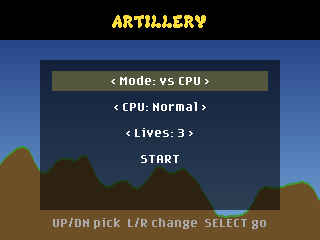
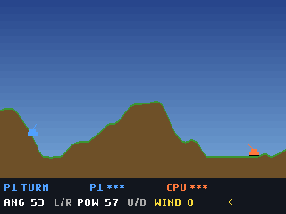
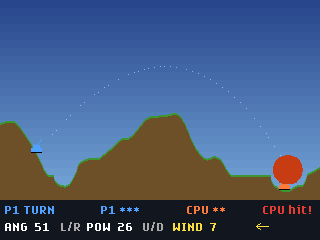

# badge-apps

Apps for the GitHub Universe 2026 badge by MrChumley.

## Artillery (`apps/artillery`)

A badge port of [Artillery](https://mrchumley.github.io/artillery/): two tanks on destructible terrain trade shots in the wind, one player against the CPU (Easy/Normal/Hard) or two players sharing the badge (hot-seat). Lives can be set to 1, 3 or 5. No Wi-Fi, sound or `secrets.py` needed.

  

### Controls

| Where | Control | Action |
| --- | --- | --- |
| Menu | Up / Down | Pick a row |
| Menu | Left / Right | Change the value (mode, CPU difficulty, lives) |
| Menu | Select | Start |
| Game | Left / Right | Aim: swing the barrel the way you press (angle) |
| Game | Up / Down | Raise / lower power |
| Game | Select | Fire |
| Game | Back, Menu or Home | Back to the menu |
| Winner screen | Select / Back | Rematch / menu |

Holding a d-pad button repeats. The yellow arrow shows the wind, which changes every turn.

### Install on a badge

1. Download this repository (Code → Download ZIP, or `git clone https://github.com/MrChumley/badge-apps`).
2. Put the badge into USB mass-storage mode so its `/system` drive (named `BADGER`) appears on your computer. See "Installing an app" in [badger/home `hardware/USB_SERIAL.md`](https://github.com/badger/home/blob/main/hardware/USB_SERIAL.md); over serial that is `mpremote connect <port> exec "import powman; powman.reset_into_msc()"`.
3. Copy the `apps/artillery` folder into `apps/` on that drive, so it ends up at `/system/apps/artillery`.
4. Eject the drive and reset the badge. Artillery appears in the menu.

`/system` is read-only over the normal serial REPL, so `mpremote fs cp` into `/system` won't work; use mass-storage mode.

### Run it in the simulator

Copy `apps/artillery` into `badge/apps/artillery` in a clone of [badger/home](https://github.com/badger/home) and open it in the Badge Simulator canvas (`.github/extensions/badge-simulator`) in the GitHub Copilot app. The simulator only approximates the badge, so try it on real hardware too.

## License

CC0-1.0, the same as the original Artillery game. See [LICENSE](LICENSE).
